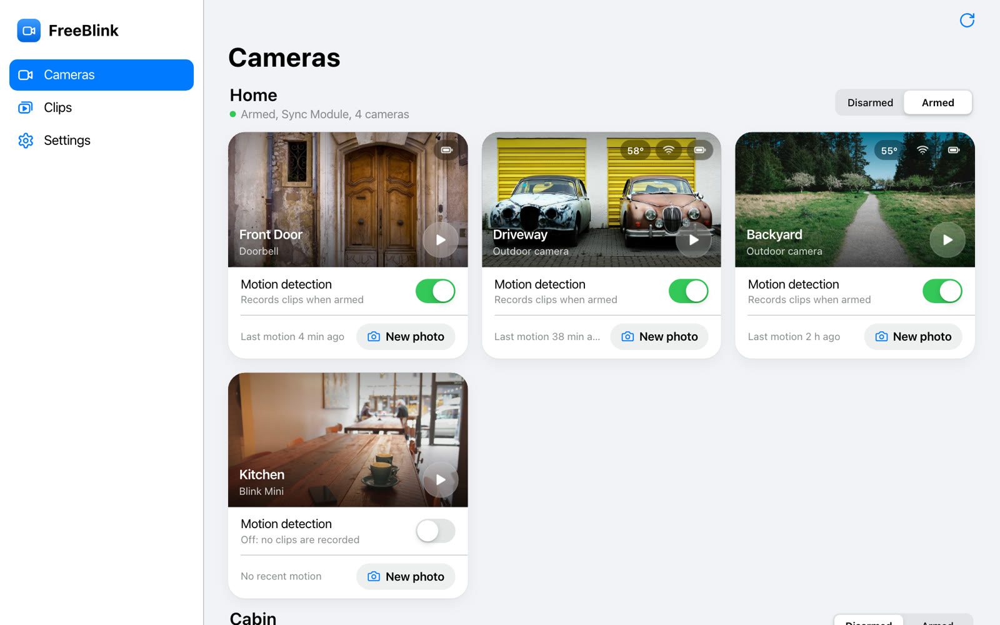
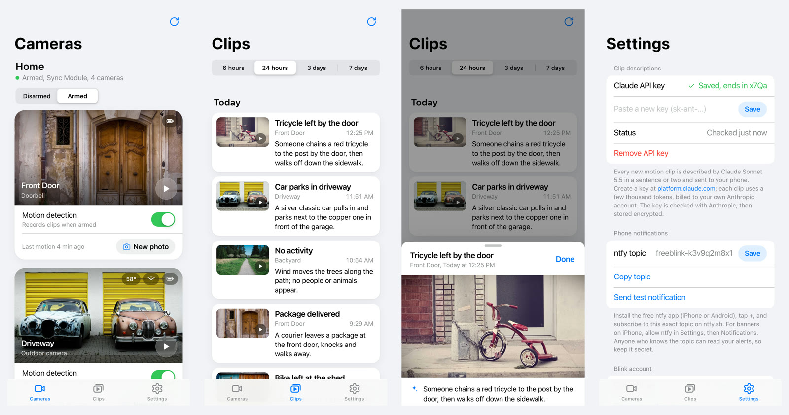
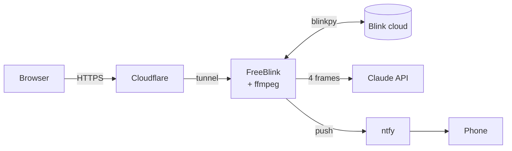
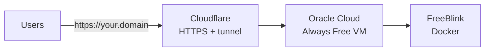

<div align="center">


# FreeBlink

**Your Blink cameras in the browser, with a short AI description of every motion clip sent to your phone.**

[](https://github.com/AndrewKuktenko/FreeBlink/actions/workflows/deploy.yml)
[](https://github.com/AndrewKuktenko/FreeBlink/pkgs/container/freeblink)


[**Open FreeBlink**](https://freeblink.app) · [Deploy your own](#deploy-your-own-free) · [Run locally](#run-locally) · [How it works](#how-it-works)

<picture>
  <source media="(prefers-color-scheme: dark)" srcset="docs/screenshots/cameras-dark.jpg">
  
</picture>

</div>

## Features

- 🎥 **Live view**: Watch any camera in the browser (HLS). On a Mini with the Pan-Tilt mount, steer it with a D-pad or the arrow keys.
- ✨ **AI clip descriptions**: Claude watches every new motion clip and writes a one-line headline and a short description, like *"A courier leaves a package at the front door."*
- 🙂 **Familiar faces** (optional, off by default): Add the people you know, and descriptions say *"Anna arrives home"* instead of *"A person arrives"*. Recognition runs on your server; Claude only gets the name.
- 📱 **Phone notifications**: Each description is pushed to your phone with the best frame attached, through the free [ntfy](https://ntfy.sh) app.
- 🗂️ **Clips**: Cloud clips and Sync Module USB clips in one timeline, playable in the browser.
- 🛡️ **Control**: Arm and disarm systems, turn motion detection on and off per camera, take a new photo. Battery, temperature and Wi-Fi at a glance.
- 👥 **Multi-user**: Anyone signs in with their own Blink account and only ever sees their own cameras.
- 🌗 **Feels native**: An iOS-style interface with dark mode, made for phones and desktop.

<picture>
  <source media="(prefers-color-scheme: dark)" srcset="docs/screenshots/phone-dark.jpg">
  
</picture>

## Get started

1. Open **[freeblink.app](https://freeblink.app)** (or [your own server](#deploy-your-own-free)) and sign in with your Blink email, password and the code Blink sends you.
2. **Optional, for AI descriptions:** in *Settings*, paste a [Claude API key](https://platform.claude.com/settings/keys). Usage is billed to your own Anthropic account, a fraction of a cent per clip.
3. **Phone alerts:** install **ntfy** ([iPhone](https://apps.apple.com/app/ntfy/id1625396347) · [Android](https://play.google.com/store/apps/details?id=io.heckel.ntfy)), tap **+** and subscribe to the topic shown in *Settings*. Then press *Send test notification*.

Without a Claude key you still get a plain "Motion" notification for each clip.

## How it works



- **Clips:** every 30 seconds FreeBlink checks Blink's cloud and the Sync Module's USB drive for new motion clips. For each one it sends 4 frames (640 px wide) to Claude Sonnet 5.5, which returns a headline and a description of at most 30 words. That's about 2,000 input and 75 output tokens per clip.
- **Live view:** Blink's live stream (MPEG-TS over its `immis` protocol) goes through ffmpeg to HLS, then to the browser with hls.js. Expect 10–20 s to connect, because battery cameras have to wake up. Streams stop about 20 s after the last viewer leaves, to save batteries.
- **Pan-Tilt mount:** commands go over the live-view socket, using the protocol recovered by [blink-camera-mcp](https://github.com/AbhijatSaxena/blink-camera-mcp).
- **Blink:** FreeBlink is built on [blinkpy](https://github.com/fronzbot/blinkpy), the library Home Assistant uses. Blink has no official API, so a Blink change can break things until blinkpy catches up.

## Privacy and security

- **Your password goes to Blink once and is never stored.** Blink's sign-in token and your Claude key are stored encrypted (Fernet).
- Every Blink account gets its own isolated space: cameras, clips, descriptions, notification topic and key. One account can never see another's cameras.
- Browsers hold a random session cookie; the server keeps only its hash. Cross-site requests are rejected, sign-in attempts are rate-limited per IP, and live views are capped per account and per server.
- **Familiar faces** are opt-in per account, behind a consent checkbox. Only the people you add are stored, as encrypted face templates (`faces.enc`); faces of anyone else are compared and dropped. Face templates are biometric data under laws such as the GDPR and Illinois' BIPA, so only add people who agreed, and check the rules where you run a public server.
- **Sign out on this device** ends the browser session; alerts keep coming. **Delete my FreeBlink data** (Settings) stops watching and erases everything for that account.

## Deploy your own (free)

FreeBlink needs a server that's always on, because it watches for clips and runs ffmpeg. The setup below costs only a domain (about $8 a year). The server has no open ports; it only makes outgoing connections.



1. **Domain:** buy one in the Cloudflare dashboard (*Domain Registration → Register Domains*).
2. **Tunnel:** *Zero Trust → Networks → Tunnels → Create a tunnel → Cloudflared*. Copy the token from the Docker install command (it starts with `eyJ`). Add a published application route for your domain with service **HTTP** → `app:8000`.
3. **Server:** create an [Oracle Cloud Always Free](https://www.oracle.com/cloud/free/) instance with **Ubuntu 24.04**. Use *VM.Standard.A1.Flex* (ARM, up to 4 CPUs / 24 GB) if there's capacity, otherwise *VM.Standard.E2.1.Micro* (1 GB) works too. Any other Linux server with Docker is fine as well.
4. **Install:** paste this into the instance's *cloud-init script* field (Advanced options → Management) when you create it, or run it over SSH:

   ```bash
   curl -fsSL https://raw.githubusercontent.com/AndrewKuktenko/FreeBlink/main/deploy/setup.sh | bash -s -- <TUNNEL_TOKEN>
   ```

The script installs Docker, adds swap on small machines, starts FreeBlink and the Cloudflare connector, and turns on automatic updates. About 10 minutes later the tunnel shows **HEALTHY** and your domain serves the sign-in page.

<details>
<summary>Without Cloudflare (Caddy + Let's Encrypt)</summary>

Pass a domain instead of a token: `... | bash -s -- freeblink.example.com`. Point the domain's DNS at the server and open ports 80 and 443 in the cloud firewall. The script opens them in the server's own firewall.
</details>

### Automatic updates

Every push to `main` deploys itself:

1. **GitHub Actions** builds the Docker image, starts it and checks that it serves the app, then publishes it to `ghcr.io/andrewkuktenko/freeblink` for amd64 and arm64.
2. **The server** runs `deploy/update.sh` every 5 minutes (cron). It pulls the latest code and image and restarts only the containers that changed.

Data lives in the `freeblink-data` Docker volume and survives updates. To follow your fork instead, set `FREEBLINK_IMAGE=ghcr.io/<you>/freeblink:latest` in `~/FreeBlink/.env`.

| Task | Command (on the server) |
| --- | --- |
| Update log | `cat /var/log/freeblink-update.log` |
| App logs | `cd ~/FreeBlink && sudo docker compose logs -f app` |
| Update now | `~/FreeBlink/deploy/update.sh` |
| Back up | Copy the `freeblink-data` volume. It contains `secret.key`, which the encrypted tokens need. |

## Run locally

Requirements: Python 3.10+ and ffmpeg (`brew install ffmpeg`).

```bash
git clone https://github.com/AndrewKuktenko/FreeBlink.git && cd FreeBlink
cp .env.example .env   # optional; the defaults run on http://127.0.0.1:8000
./run.sh
```

Or with Docker: `docker compose up --build` builds the image locally.

<details>
<summary>Settings (.env)</summary>

| Variable | Default | What it does |
| --- | --- | --- |
| `SECRET_KEY` | generated in `data/secret.key` | Encrypts Blink tokens and Claude keys |
| `AI_MODEL` | `claude-sonnet-5-5` | Model that describes clips |
| `AI_FRAMES`, `AI_FRAME_WIDTH` | `4`, `640` | Frames per clip and their width; below 640 px, distant people get missed |
| `NTFY_SERVER` | `https://ntfy.sh` | Push server (self-hosted ntfy works) |
| `MAX_LIVE_PER_USER`, `MAX_LIVE_TOTAL` | `2`, `8` | Concurrent live views |
| `INACTIVE_DAYS` | `60` | Pause accounts nobody has opened for this long |
| `DETECT_ENGINE` | `claude` | `yolo` labels objects locally instead (`pip install ultralytics`); no descriptions |
| `FACES_ENABLED` | `false` | Lets accounts turn on familiar faces in Settings. On first use it downloads InsightFace's `buffalo_s` models (non-commercial licence) into `data/models` |
| `FACES_ACCOUNTS` | empty | Only these Blink emails (comma-separated) may use familiar faces; empty = every account |
| `FACES_THRESHOLD` | `0.45` | Similarity needed to name someone; raise it if you see wrong names |

The full list, with comments, is in [`.env.example`](.env.example).
</details>

## Project layout

| Path | What it does |
| --- | --- |
| `app/main.py` | FastAPI routes, session cookies, cross-site request protection |
| `app/tenants.py` | Accounts: per-Blink-account isolation, sessions, 2FA, rate limits, deletion |
| `app/blink_service.py` | One Blink session: sign-in, encrypted token, polling, arm, photos, clips |
| `app/events.py`, `app/claude_vision.py` | Clip watcher and Claude descriptions |
| `app/faces.py` | Familiar faces: local face detection and matching, encrypted per-account templates |
| `app/live.py`, `app/pantilt.py` | Live view (Blink → ffmpeg → HLS) and the Pan-Tilt mount |
| `static/` | The web app (plain HTML, CSS and JavaScript) |
| `Dockerfile`, `docker-compose.yml`, `deploy/` | Container, Cloudflare Tunnel / Caddy, setup and auto-update scripts |
| `.github/workflows/deploy.yml` | Build, smoke-test and publish the image |

**Not supported yet:** two-way talk on the doorbell (blinkpy doesn't implement it).

## Credits

- [blinkpy](https://github.com/fronzbot/blinkpy) for the Blink API, and [blink-camera-mcp](https://github.com/AbhijatSaxena/blink-camera-mcp) (MIT) for the Pan-Tilt protocol.
- The screenshots use demo data and photos from [Unsplash](https://unsplash.com) (Paul Evans, Dietmar Becker, Paul Jarvis, Luke Chesser, Florian Klauer), not real camera footage.

## Disclaimer

FreeBlink is an unofficial personal project. It is not affiliated with, endorsed by or supported by Blink or Amazon. It uses Blink's private, undocumented API, so use it at your own risk. Automated access to Blink accounts may conflict with Blink's terms of service.

If you run a FreeBlink server for other people, you hold their Blink sign-in tokens and home video. Keep the server updated, keep backups of the data volume private, and tell your users how to delete their data.
